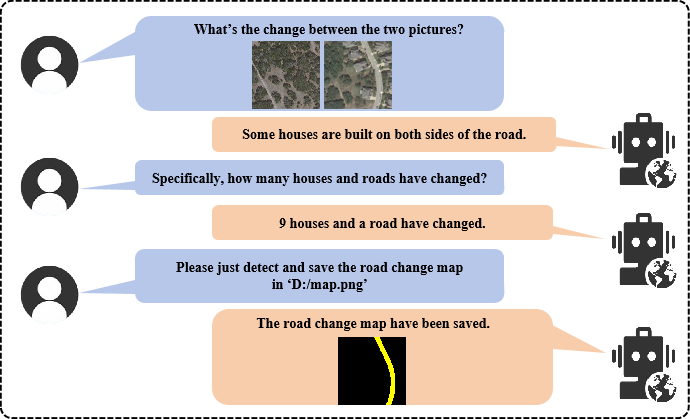
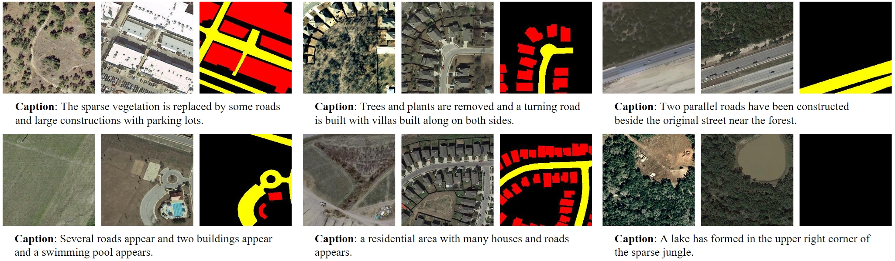
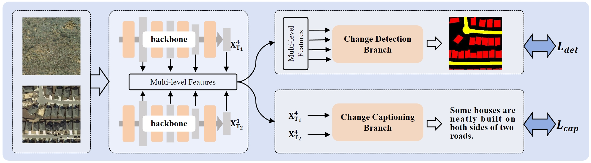
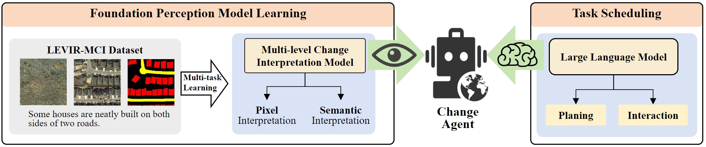
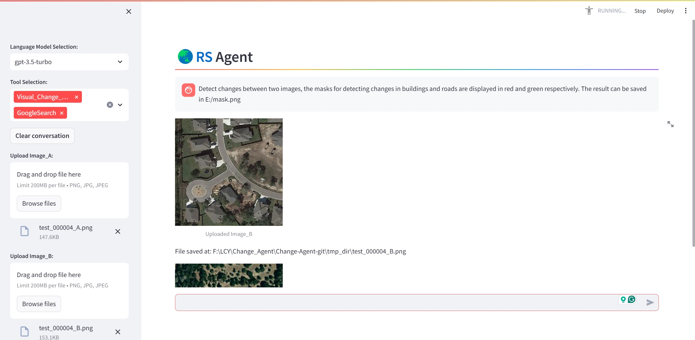

<<<<<<< HEAD
<div align="center">
    
<h1><a href="https://ieeexplore.ieee.org/document/10591792">Change-Agent: Toward Interactive Comprehensive Remote Sensing Change Interpretation and Analysis</a></h1>

**[Chenyang Liu](https://chen-yang-liu.github.io/), [Keyan Chen](https://kyanchen.github.io), [Haotian Zhang](https://scholar.google.com/citations?user=c7uR6NUAAAAJ), [Zipeng Qi](https://scholar.google.com/citations?user=KhMtmBsAAAAJ), [Zhengxia Zou](https://scholar.google.com.hk/citations?hl=en&user=DzwoyZsAAAAJ), and [Zhenwei Shi*✉](https://scholar.google.com.hk/citations?hl=en&user=kNhFWQIAAAAJ)**

<div align="center">
  
</div>
</div>

## Share us a :star: if you're interested in this repo

Official PyTorch implementation of the paper: "**Change-Agent: Toward Interactive Comprehensive Remote Sensing Change Interpretation and Analysis**" in [[IEEE](https://ieeexplore.ieee.org/document/10591792)]  ***(Accepted by IEEE TGRS 2024)***

## 🥳News

- 2024-06: The code is **available**.
- 2024-03: The paper is **available**.
- 🔥 Our survey "**Remote Sensing Temporal Vision-Language Models: A Comprehensive Survey": [Arxiv](https://arxiv.org/abs/2412.02573) || [Github](https://github.com/Chen-Yang-Liu/Awesome-RS-Temporal-VLM)** 🔥 

## Table of Contents
- [LEVIR-MCI dataset](#LEVIR-MCI-dataset)
- [Training of MCI model](#Training-of-the-multi-level-change-interpretation-model)
- [Construction of Change-Agent](#Construction-of-Change-Agent)
- [Citation](#Citation)

## LEVIR-MCI dataset 
- Download the LEVIR_MCI dataset: [LEVIR-MCI](https://huggingface.co/datasets/lcybuaa/LEVIR-MCI/tree/main) (**Available Now!**).
- This dataset is an extension of our previously established [LEVIR-CC dataset](https://github.com/Chen-Yang-Liu/RSICC). It contains bi-temporal images as well as diverse change detection masks and descriptive sentences. It provides a crucial data foundation for exploring multi-task learning for change detection and change captioning.
    <br>
    <div align="center">
      
    </div>
    <br>
## Training of the multi-level change interpretation model
The overview of the MCI model:
<br>
    <div align="center">
      
    </div>
<br>

### Preparation
    
- **Environment Installation**:
    <details open>
    
    **Step 1**: Create a virtual environment named `Multi_change_env` and activate it.
    ```python
    conda create -n Multi_change_env python=3.9
    conda activate Multi_change_env
    ```
    
    **Step 2**: Download or clone the repository.
    ```python
    git clone https://github.com/Chen-Yang-Liu/Change-Agent.git
    cd ./Change-Agent/Multi_change
    ```
    
    **Step 3**: Install dependencies.
    ```python
    pip install -r requirements.txt
    ```
    </details>

- **Download Dataset**:
  <details open>
      
  Link: [LEVIR-MCI](https://huggingface.co/datasets/lcybuaa/LEVIR-MCI/tree/main). The data structure of LEVIR-MCI is organized as follows:

    ```
    ├─/DATA_PATH_ROOT/Levir-MCI-dataset/
            ├─LevirCCcaptions.json
            ├─images
                 ├─train
                 │  ├─A
                 │  ├─B
                 │  ├─label
                 ├─val
                 │  ├─A
                 │  ├─B
                 │  ├─label
                 ├─test
                 │  ├─A
                 │  ├─B
                 │  ├─label
    ```
    where folder ``A`` contains pre-phase images, folder ``B`` contains post-phase images, and folder ``label`` contains the change detection masks.
    </details>

- **Extract text files for the descriptions of each image pair in LEVIR-MCI**:

    ```
    python preprocess_data.py
    ```
    After that, you can find some generated files in `./data/LEVIR_MCI/`. 

### Train
Make sure you performed the data preparation above. Then, start training as follows:
```python
python train.py --train_goal 2 --data_folder /DATA_PATH_ROOT/Levir-MCI-dataset/images --savepath ./models_ckpt/
```

### Evaluate
```python
python test.py --data_folder /DATA_PATH_ROOT/Levir-MCI-dataset/images --checkpoint {checkpoint_PATH}
```
We recommend training the model 5 times to get an average score.

### Inference
Run inference to get started as follows:
```python
python predict.py --imgA_path {imgA_path} --imgB_path {imgA_path} --mask_save_path ./CDmask.png
```
You can modify ``--checkpoint`` of ``Change_Perception.define_args()`` in ``predict.py``. Then you can use your own model, of course, you also can download our pretrained model ``MCI_model.pth`` here: [[Hugging face](https://huggingface.co/lcybuaa/Change-Agent/tree/main)]. After that, put it in `./models_ckpt/`.


## Construction of Change-Agent
<br>
<div align="center">
      
</div>

- **Agent Installation**:
    ```python
    cd ./Change-Agent/lagent-main
    pip install -e .[all]
    ```
- **Run Agent**:

    cd into the ``Multi_change`` folder:
    ```python
    cd ./Change-Agent/Multi_change
    ```
    (1) Run Agent Cli Demo:
    ```bash
    # You need to install streamlit first
    # pip install streamlit
    python try_chat.py
    ```
        
    (2) Run Agent Web Demo:
    ```bash
    # You need to install streamlit first
    # pip install streamlit
    streamlit run react_web_demo.py
    ```
    <br>
    <div align="center">
          
    </div>

## Citation
If you find this paper useful in your research, please consider citing:
```
@ARTICLE{Liu_Change_Agent,
  author={Liu, Chenyang and Chen, Keyan and Zhang, Haotian and Qi, Zipeng and Zou, Zhengxia and Shi, Zhenwei},
  journal={IEEE Transactions on Geoscience and Remote Sensing}, 
  title={Change-Agent: Toward Interactive Comprehensive Remote Sensing Change Interpretation and Analysis}, 
  year={2024},
  volume={},
  number={},
  pages={1-1},
  keywords={Remote sensing;Feature extraction;Semantics;Transformers;Roads;Earth;Task analysis;Interactive Change-Agent;change captioning;change detection;multi-task learning;large language model},
  doi={10.1109/TGRS.2024.3425815}}

```

## Acknowledgement
Thanks to the following repository:

[RSICCformer](https://github.com/Chen-Yang-Liu/RSICC); [Chg2Cap](https://github.com/ShizhenChang/Chg2Cap); [lagent](https://github.com/InternLM/lagent)

## License
This repo is distributed under [MIT License](https://github.com/Chen-Yang-Liu/Change-Agent/blob/main/LICENSE.txt). The code can be used for academic purposes only.

## Contact Us
If you have any other questions❓, please contact us in time 👬
=======
# Urban_Change_Detection


## Getting started

To make it easy for you to get started with GitLab, here's a list of recommended next steps.

Already a pro? Just edit this README.md and make it your own. Want to make it easy? [Use the template at the bottom](#editing-this-readme)!

## Add your files

- [ ] [Create](https://docs.gitlab.com/ee/user/project/repository/web_editor.html#create-a-file) or [upload](https://docs.gitlab.com/ee/user/project/repository/web_editor.html#upload-a-file) files
- [ ] [Add files using the command line](https://docs.gitlab.com/ee/gitlab-basics/add-file.html#add-a-file-using-the-command-line) or push an existing Git repository with the following command:

```
cd existing_repo
git remote add origin https://git01.iis.fhg.de/nemade/urban_change_detection.git
git branch -M master
git push -uf origin master
```

## Integrate with your tools

- [ ] [Set up project integrations](https://git01.iis.fhg.de/nemade/urban_change_detection/-/settings/integrations)

## Collaborate with your team

- [ ] [Invite team members and collaborators](https://docs.gitlab.com/ee/user/project/members/)
- [ ] [Create a new merge request](https://docs.gitlab.com/ee/user/project/merge_requests/creating_merge_requests.html)
- [ ] [Automatically close issues from merge requests](https://docs.gitlab.com/ee/user/project/issues/managing_issues.html#closing-issues-automatically)
- [ ] [Enable merge request approvals](https://docs.gitlab.com/ee/user/project/merge_requests/approvals/)
- [ ] [Set auto-merge](https://docs.gitlab.com/ee/user/project/merge_requests/merge_when_pipeline_succeeds.html)

## Test and Deploy

Use the built-in continuous integration in GitLab.

- [ ] [Get started with GitLab CI/CD](https://docs.gitlab.com/ee/ci/quick_start/index.html)
- [ ] [Analyze your code for known vulnerabilities with Static Application Security Testing (SAST)](https://docs.gitlab.com/ee/user/application_security/sast/)
- [ ] [Deploy to Kubernetes, Amazon EC2, or Amazon ECS using Auto Deploy](https://docs.gitlab.com/ee/topics/autodevops/requirements.html)
- [ ] [Use pull-based deployments for improved Kubernetes management](https://docs.gitlab.com/ee/user/clusters/agent/)
- [ ] [Set up protected environments](https://docs.gitlab.com/ee/ci/environments/protected_environments.html)

***

# Editing this README

When you're ready to make this README your own, just edit this file and use the handy template below (or feel free to structure it however you want - this is just a starting point!). Thanks to [makeareadme.com](https://www.makeareadme.com/) for this template.

## Suggestions for a good README

Every project is different, so consider which of these sections apply to yours. The sections used in the template are suggestions for most open source projects. Also keep in mind that while a README can be too long and detailed, too long is better than too short. If you think your README is too long, consider utilizing another form of documentation rather than cutting out information.

## Name
Choose a self-explaining name for your project.

## Description
Let people know what your project can do specifically. Provide context and add a link to any reference visitors might be unfamiliar with. A list of Features or a Background subsection can also be added here. If there are alternatives to your project, this is a good place to list differentiating factors.

## Badges
On some READMEs, you may see small images that convey metadata, such as whether or not all the tests are passing for the project. You can use Shields to add some to your README. Many services also have instructions for adding a badge.

## Visuals
Depending on what you are making, it can be a good idea to include screenshots or even a video (you'll frequently see GIFs rather than actual videos). Tools like ttygif can help, but check out Asciinema for a more sophisticated method.

## Installation
Within a particular ecosystem, there may be a common way of installing things, such as using Yarn, NuGet, or Homebrew. However, consider the possibility that whoever is reading your README is a novice and would like more guidance. Listing specific steps helps remove ambiguity and gets people to using your project as quickly as possible. If it only runs in a specific context like a particular programming language version or operating system or has dependencies that have to be installed manually, also add a Requirements subsection.

## Usage
Use examples liberally, and show the expected output if you can. It's helpful to have inline the smallest example of usage that you can demonstrate, while providing links to more sophisticated examples if they are too long to reasonably include in the README.

## Support
Tell people where they can go to for help. It can be any combination of an issue tracker, a chat room, an email address, etc.

## Roadmap
If you have ideas for releases in the future, it is a good idea to list them in the README.

## Contributing
State if you are open to contributions and what your requirements are for accepting them.

For people who want to make changes to your project, it's helpful to have some documentation on how to get started. Perhaps there is a script that they should run or some environment variables that they need to set. Make these steps explicit. These instructions could also be useful to your future self.

You can also document commands to lint the code or run tests. These steps help to ensure high code quality and reduce the likelihood that the changes inadvertently break something. Having instructions for running tests is especially helpful if it requires external setup, such as starting a Selenium server for testing in a browser.

## Authors and acknowledgment
Show your appreciation to those who have contributed to the project.

## License
For open source projects, say how it is licensed.

## Project status
If you have run out of energy or time for your project, put a note at the top of the README saying that development has slowed down or stopped completely. Someone may choose to fork your project or volunteer to step in as a maintainer or owner, allowing your project to keep going. You can also make an explicit request for maintainers.
>>>>>>> 4210f2c8e33f37faaef9f3f20d3de11b97107487
