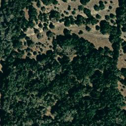
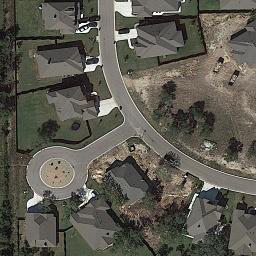
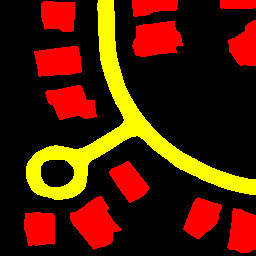
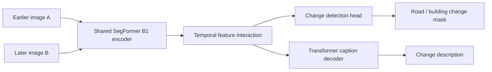

<div align="center">

# Urban Change Detection & Change Captioning

**Locate the change. Describe the transition. Read the city in both directions.**

Geospatial vision and language for interpreting two satellite images, with temporal reversal experiments for construction and removal scenarios.

[Model weights](https://huggingface.co/sushantnemade/MCI_augmented) · [Augmented dataset](https://huggingface.co/datasets/sushantnemade/LEVIR-MCI-augmented) · [Architecture](docs/architecture.md) · [Training guide](docs/training.md)

</div>

---

## One image pair, two complementary outputs

Given an **earlier image A** and a spatially aligned **later image B**, the model produces:

- A pixel-level mask of changes to **roads** and **buildings**.
- A natural-language caption describing the observed transition.

The project adapts the dual-head MCI model from [Change-Agent](https://github.com/Chen-Yang-Liu/Change-Agent), and adds a workflow for reversing image order and rewriting captions to study removal and deconstruction cases. The architecture is inherited research work; the augmentation experiments, training workflow, and this project’s engineering build on that foundation.

> **Direction matters.** Swapping A and B reverses the temporal story. Mask labels identify the *type of changed object*, not whether it was added or removed. Direction is expressed in the caption.

| Earlier image | Later image | Predicted change mask |
|:---:|:---:|:---:|
|  |  |  |

**A → B:** “the woods disappear and a t-shaped road is built with villas built along”
**B → A:** “trees are added , and a road with villas along it is removed”

*Actual captions from the verified augmented checkpoint, beam size 5, on original LEVIR-MCI test pair `test_000004`. Input images originate from LEVIR-MCI / Change-Agent and were read unchanged from the linked original archive; the mask is this model’s prediction. Reversed order illustrates removal language, not an independent historical demolition event. [Provenance](docs/assets/examples/provenance.json) · [More qualitative results](docs/results.md).*

## Start with your own pair

Use Python **3.11–3.12**. The tested cloud environment uses Python 3.12 and PyTorch 2.14 on CPU. A CUDA GPU is recommended for training.

```bash
git clone https://github.com/Sushant-Nemade/ChangeDetection-ChangeCaptioning.git urban-change-detection-captioning
cd urban-change-detection-captioning
python -m venv .venv
source .venv/bin/activate

python -m pip install torch==2.14.1 torchvision==0.29.1 \
  --index-url https://download.pytorch.org/whl/cpu
python -m pip install -e '.[demo]'

urban-change download model --output artifacts/MCI_model_augmented.pth
urban-change predict \
  --checkpoint artifacts/MCI_model_augmented.pth \
  --image-a path/to/earlier.png \
  --image-b path/to/later.png \
  --device auto \
  --output outputs/first-pair
```

On Windows, activate with `.venv\Scripts\Activate.ps1`. For CUDA and the tested Linux CPU dependency snapshot, see [installation](docs/installation.md).

Each prediction writes `mask.png`, indexed `labels.png`, `caption.txt`, and `prediction.json` with the checkpoint SHA-256 and inference timing. Downloads use pinned artifact revisions and mandatory SHA-256 verification.

| Label | Meaning | Visualization |
|---|---|---|
| `0` | Unchanged | Black |
| `1` | Road change | Yellow |
| `2` | Building change | Red |

## Explore interactively

```bash
python -m streamlit run apps/streamlit_app.py
```

Load the checkpoint, upload earlier and later images, then select **Detect and describe changes**. Download the caption, mask, labels, and metadata as a ZIP file. Inputs are normalized and resized to 256 × 256; the output mask is restored to the earlier image’s size.

The Python API and optional FastAPI service use the same predictor. See [inference and serving](docs/inference.md).

## Follow the experiment lifecycle

| Stage | Command | What it records |
|---|---|---|
| Obtain artifacts | `urban-change download` | Pinned revision and verified checksum |
| Prepare annotations | `urban-change prepare` | Splits, tokens, vocabulary, metadata summary |
| Validate inputs | `urban-change validate-data` | File/label checks and unknown-token statistics |
| Reverse temporal pairs | `urban-change augment` | Source-to-reversal mapping and caption provenance |
| Train or fine-tune | `urban-change train` | Configuration, metrics, optimizer/scaler/RNG state |
| Evaluate | `urban-change evaluate` | Split/checkpoint hashes, sample count, metric coverage |

Read the [data guide](docs/data.md), [training guide](docs/training.md), and [evaluation protocol](docs/evaluation.md). Keep original and reversed versions of a pair in the same split. New augmentation defaults to training samples; building a new vocabulary uses training captions only.

## How the model is organized



The model retains its original checkpoint parameter names. A full MCI checkpoint contains encoder weights, so inference does **not** need a separate backbone download. Fresh stage-one training can initialize from a separately verified SegFormer backbone.

```text
apps/                        Streamlit launch script
configs/                     Training recipes
docs/                        Architecture, workflows, results, publication notes
  huggingface/               Model-card and dataset-card drafts
requirements/                Reproducible Linux CPU dependency snapshot
src/urban_change/
  assets/                    Checksum manifest and published vocabularies
  data/                      Preparation, validation, augmentation, dataset loader
  evaluation/                Segmentation and caption metrics
  models/                    Checkpoint-compatible model components
  training/                  Staged optimization and experiment resume
  api.py                     Optional HTTP service
  cli.py                     Command-line entry points
  inference.py               Shared prediction implementation
  ui.py                      Interactive demo
tests/                       Data, model, service, and regression checks
third_party/                 Preserved license notices
```

Downloaded data, weights, generated tokens, and run outputs stay in ignored local directories. The former `lagent-main` framework and unrelated resource diagrams are removed. [Migration notes](docs/migration.md) map the old scripts to their replacements.

## Results and scope

The verified trained checkpoint runs on original and reversed test pairs. Archive metadata contains 10,077 original pairs and 15,115 augmented pairs, each with five captions. A full benchmark still requires exact split and decoding settings; scores embedded in old checkpoint filenames are not treated as reproduced test results. See [results and validation](docs/results.md) for the measured software checks, qualitative predictions, and the author’s separate removal-case montage still to be supplied.

This is a research implementation for aligned urban satellite imagery. Captions can omit or misdescribe changes, particularly outside the training domain. Verify predictions against the images and masks; reversing inputs alone does not establish reliable removal detection.

## Develop and contribute

```bash
python -m pip install -e '.[demo,api,augmentation,dev]'
python -m pytest -m 'not integration'
ruff check src tests apps
ruff format --check src tests apps
```

Integration checks exercise the full model, HTTP prediction, and training/resume when compatible local artifacts are supplied. See [contributing](CONTRIBUTING.md) and the [implementation plan](docs/implementation-plan.md).

## Attribution and licensing

This project builds on **Change-Agent / LEVIR-MCI** by Chenyang Liu, Keyan Chen, Haotian Zhang, Zipeng Qi, Zhengxia Zou, and Zhenwei Shi. Cite their dataset and model work when using the underlying architecture or data:

> Liu et al. *Change-Agent: Toward Interactive Comprehensive Remote Sensing Change Interpretation and Analysis.* IEEE Transactions on Geoscience and Remote Sensing, 2024. [DOI: 10.1109/TGRS.2024.3425815](https://doi.org/10.1109/TGRS.2024.3425815).

Source licensing is mixed: the inherited Change-Agent code has an MIT notice, while the SegFormer implementation is covered by NVIDIA’s source license with a **non-commercial-use limitation**. COCO-caption notices are retained. Dataset imagery and external checkpoints need their own license review; existing Hub metadata alone does not resolve these terms. See [third-party notices](THIRD_PARTY_NOTICES.md) and [publication notes](docs/publication.md). The new name does not change the authorship of inherited research components.
