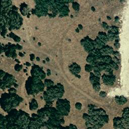
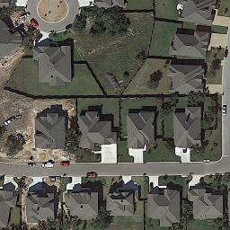
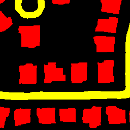

# Results and validation

## Software evidence

The current CPU environment has exercised the following behaviors:

- Original encoder/neck feature tensors, segmentation logits, and beam-search token sequences match the reorganized model. The captured fixture uses a bundled pretrained backbone and explicitly **untrained task heads**. It verifies numerical compatibility, not prediction quality.
- Decoder gradients, full model execution, mask restoration, dataset loading, temporal reversal, output files, UI error handling, and HTTP inference execute successfully.
- A tiny CPU caption fine-tuning run executes an optimizer step from a partial accumulation window, saves optimizer/scaler/RNG state, and resumes for a second epoch.

See the test suite and `docs/validation-report.json` for final recorded checks. Smoke-test metrics on synthetic image fixtures are not reported as model benchmark scores.

## Verified trained-model examples

`MCI_model_augmented.pth` was downloaded and verified against SHA-256 `5ca0b07c82d633a37e98d0a001247fb0283976209eb6c50cd56afdf33796ee46`. A fresh installed wheel ran CPU inference on two real original LEVIR-MCI test pairs in both directions, with beam size 5:

| Test pair | Input order | Generated caption, verbatim |
|---|---|---|
| `test_000004` | A → B | the woods disappear and a t-shaped road is built with villas built along |
| `test_000004` | B → A | trees are added , and a road with villas along it is removed |
| `test_000017` | A → B | trees are removed and a residential area has been built with rows of villas built along |
| `test_000017` | B → A | many houses are removed along the road |

The live HTTP service also produced a trained-model prediction on a real pair. These are functional and qualitative checks, not a complete accuracy evaluation. The reversed inputs are temporally reversed examples rather than independent historical removal observations. Input bytes and generated mask provenance are recorded in [the example manifest](assets/examples/provenance.json).

| Earlier image (`test_000017`) | Later image | Predicted mask |
|:---:|:---:|:---:|
|  |  |  |

No full-dataset benchmark is reported. Numerical values in historical checkpoint names are not a substitute for a reproducible evaluation report.

## Removal/deconstruction illustration

The author’s montage, `Removal Case Sample Images.png`, is currently available only at a Windows path supplied in the request. It has not been received in this cloud workspace and is not included or reconstructed. Once supplied, add it under `docs/assets/`, record the source checkpoint and image IDs, and label observed inputs, ground truth, masks, and generated captions clearly.

The README’s source images come from the original LEVIR-MCI archive and are attributed separately. Its displayed masks/captions are actual predictions from the verified checkpoint; they are not the author’s missing montage.

## Remaining evaluation

Run the [evaluation protocol](evaluation.md) on the complete archive and exact vocabulary, reporting original chronological and reversed pairs separately. GPU training, mixed precision, full-dataset accuracy, optional Java METEOR, and broad removal-case reliability remain unverified in this environment.
